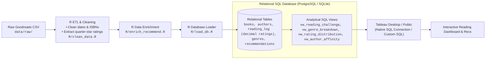

# Tableau Goodreads Dashboard: AI Agent Task Roadmap & SQL Architecture

An end-to-end analytics and visualization project designed to ingest raw Goodreads library exports, clean and enrich reading data using **R** (including extracting fractional / quarter-star ratings), store it in a relational SQL database, and build an interactive, high-impact reading insights and recommendation dashboard in Tableau connected directly to the database.

---

## 📌 Project Overview

This project guides an AI-assisted workflow to transform personal Goodreads reading history into a structured relational database and an engaging Tableau dashboard. By pairing automated **R** ETL (`tidyverse`), quarter-star rating extraction (e.g., `1.25`, `3.75`, `4.75`), and genre enrichment with a relational SQL database (e.g., PostgreSQL or SQLite), users can execute custom SQL queries, build reusable analytical views, and connect Tableau directly to the database via native SQL connectors for dynamic reporting and personalized book recommendations.

---

## 🏗️ Architecture & Data Pipeline



---

## 🗺️ High-Level AI Agent Roadmap

### Phase 1: Data Preparation & Cleaning (R & Tidyverse)
**Objective:** Ingest, parse, and clean the raw Goodreads CSV export using R to produce structured tabular datasets (`tibble` / data frame) with full support for fractional ratings.

**Agent Instructions:**
- **Parse Goodreads Export:** Ingest and parse the raw Goodreads CSV file (`data/raw/goodreads_library_export.csv`) using `readr::read_csv()`.
- **Clean Data Fields:**
  - Standardize date formats (`Date Read`, `Date Added`) to ISO `YYYY-MM-DD` using `lubridate::ymd()` or `readr::col_date()`.
  - Handle missing values (e.g., books marked as `to-read` or `currently-reading` lacking read dates).
  - Strip formula-wrapped identifiers (e.g., `=""1728295807""` -> `1728295807` on ISBN/ISBN13 fields) using `stringr::str_remove_all()`.
- **Quarter-Star & Fractional Rating Extraction:**
  - *Context:* Goodreads natively only captures integer ratings (1–5). Readers frequently record more granular quarter-star ratings (e.g., `1.25`, `2.75`, `3.50`, `4.75`) in `My Review`, `Private Notes`, or custom bookshelf tags (e.g., `4-25-stars`, `rating-4-75`).
  - *Parsing Logic:* Use regular expressions via `stringr::str_match()` (e.g., `r'(\d(?:\.25|\.5|\.50|\.75)?)\s*(?:/\s*5|\s*stars?)'`) to scan `Private Notes`, `My Review`, and tags for quarter-star ratings.
  - *Fallback & Standardize:* When an explicit quarter-star rating is detected, set `my_rating` to that decimal value; otherwise fall back to the Goodreads integer `My Rating`. Store both the precision decimal `my_rating` (`NUMERIC(3, 2)`) and `raw_goodreads_rating` (`INT`). Unrated books (0) map to `NA` / `NULL` for rating calculations.
- **Extract Key Dimensions:** Extract primary/secondary genres (from tags or bookshelves), author names, page counts, publisher, and publication years using `dplyr` transformations.
- **Output Clean Data:** Output cleaned intermediate files or data frames ready for enrichment and database loading.

---

### Phase 2: Data Enrichment (Genres & Recommendations Prep)
**Objective:** Fill in missing metadata (subgenres, themes, ratings count) using R HTTP/JSON tools and generate candidate book recommendations.

**Agent Instructions:**
- **Genre Mapping & Categorization:** Map raw Goodreads bookshelves/tags to clean, standardized genre categories (e.g., Sci-Fi, Mystery, Historical Fiction, Non-Fiction) using book APIs (Open Library / Google Books) via `httr2` and `jsonlite`, or rule-based heuristics.
- **User Preference Profiling:** Profile reading taste with `dplyr` using granular decimal ratings:
  - Average user rating per genre (calculated on precision decimal ratings).
  - Volume of books read per genre.
  - Author affinity scores (combination of read frequency and decimal average rating).
- **Recommendation Candidate Generation:** Generate a scored candidate list of recommendations matching top genres and high-rated authors for unread books or external popular titles.

---

### Phase 3: Relational Database Modeling & Ingestion
**Objective:** Define a normalized relational schema with precision decimal rating support, create database tables, and automate ingestion from R into a SQL database.

**Agent Instructions:**
- **Choose Database Engine:**
  - **PostgreSQL (Recommended):** Native, zero-config connector support in Tableau Desktop, robust analytical window functions, decimal precision types, and multi-user performance.
  - **SQLite (Lightweight Alternative):** Serverless, zero-install local file database (connectable to Tableau via SQLite ODBC driver).
- **Design Relational Schema (`sql/schema.sql`):**
  - `authors` (`author_id` PK, `name`, `name_lf`)
  - `books` (`book_id` PK, `title`, `author_id` FK, `isbn`, `isbn13`, `publisher`, `binding`, `page_count`, `publication_year`)
  - `genres` (`genre_id` PK, `genre_name`)
  - `book_genres` (`book_id` FK, `genre_id` FK) — many-to-many relationship
  - `reading_log` (`log_id` PK, `book_id` FK, `my_rating NUMERIC(3, 2)`, `raw_goodreads_rating INT`, `date_read`, `date_added`, `exclusive_shelf`, `read_count`, `my_review`)
    - *Constraint:* `CHECK (my_rating >= 0.00 AND my_rating <= 5.00 AND MOD(my_rating * 100, 25) = 0)` to guarantee valid quarter-star intervals (0.25, 0.50, 0.75, etc.).
  - `recommendations` (`rec_id` PK, `title`, `author`, `genre_id` FK, `average_rating NUMERIC(3, 2)`, `reason`, `source`)
- **Automated Database Ingestion (`R/load_db.R`):**
  - Implement a database loader script in R using `DBI` along with `RPostgres` (for PostgreSQL) or `RSQLite` (for SQLite).
  - Support idempotent upserts or clean table refreshes (`DBI::dbWriteTable()` with `append = TRUE` / `overwrite = TRUE` or SQL staging) when new reading logs are exported.

---

### Phase 4: SQL Modeling & Analytical Views
**Objective:** Build analytical SQL views and ad-hoc queries so Tableau can directly query clean, performant pre-aggregated metrics.

**Agent Instructions:**
- **Create Analytical Views (`sql/views.sql`):**
  - `vw_reading_challenge_progress`: Books completed per calendar year vs. target goals, pacing by month and week.
  - `vw_genre_breakdown`: Total books read, pages read, and average rating aggregated by primary genre.
  - `vw_rating_distribution`: Book counts and percentages grouped by quarter-star rating bins (`1.00`, `1.25`, `1.50`, ..., `4.75`, `5.00`).
  - `vw_author_affinity`: Aggregated author statistics (books read, average decimal rating, star distributions) and composite affinity scoring.
  - `vw_top_rated_books`: Filtered view of high-tier reads (`my_rating >= 4.25`) with metadata, exact decimal ratings, read dates, and reviews for highlight cards.
  - `vw_book_recommendations`: Scored recommendation feed with rationale tags (e.g., *"Because you loved Project Hail Mary (4.75★)"*).
- **Ad-Hoc SQL Query Library (`sql/queries/`):**
  - Maintain reusable SQL scripts for exploratory data analysis (EDA), yearly summaries, rating distributions, reading velocity (pages per day), and shelf transitions.

---

### Phase 5: Tableau Database Connection & Metric Engineering
**Objective:** Connect Tableau Desktop directly to the SQL database and configure Tableau calculated fields and parameters.

**Agent Instructions:**
- **Tableau Database Connection:**
  - Connect Tableau Desktop to PostgreSQL via the native PostgreSQL connection dialog (Host, Port, Database, User, Password).
  - Choose between **Live Connection** (direct real-time SQL execution) or **Extract** (in-memory snapshot refreshed on demand).
  - Bring in analytical views (`vw_*`) or write Tableau **Custom SQL** queries.
- **Tableau Calculated Fields & Parameters:**
  - **Reading Goal Parameter:** Integer parameter allowing the user to dynamically adjust their annual reading goal (e.g., 25, 30, 50 books).
  - **Reading Challenge Progress Calculation:**
    $$\text{Reading Challenge Progress} = \frac{\text{COUNT}(\text{Books Read in Current Year})}{[\text{Goal Parameter}]}$$
  - **Quarter-Star Visual Formatter:** Calculated field creating a clean formatted rating string with quarter glyphs or exact badges:
    ```tableau
    // Example: Formatted Star Label
    STR([My Rating]) + " ★"
    ```
  - **Quarter-Star Bins:** Dimension calculation for histogram binning:
    ```tableau
    FLOAT(INT([My Rating] * 4) / 4)
    ```
  - **Refined Rating Tiers:** Granular categorical field reflecting quarter-star precision:
    - *Masterpiece / All-Time Favorite:* `4.75 – 5.00 ★`
    - *Highly Recommended:* `4.25 – 4.50 ★`
    - *Solid Read:* `3.50 – 4.00 ★`
    - *Mixed / Average:* `2.75 – 3.25 ★`
    - *Disappointing:* `< 2.75 ★`

---

### Phase 6: Dashboard Layout & Visualization Design
**Objective:** Design an interactive, visually polished Tableau dashboard connected to the SQL database.

**Agent Instructions:**
- **Reading Challenge Gauge / Progress Bar:** Visual bullet chart or donut progress indicator displaying year-to-date reading vs. annual goal.
- **Quarter-Star Rating Distribution:** Bar chart / histogram with `0.25` step binning displaying the exact frequency of ratings (`3.25`, `3.50`, `3.75`, `4.00`, `4.25`, `4.50`, `4.75`, `5.00`).
- **Top-Rated Books Showcase:** Filterable gallery or card grid of top-rated books (`>= 4.25 ★`) showcasing exact decimal rating badges (`4.75 ★`), cover/title, page count, and completion date.
- **Genre Insights (Volume vs. Rating):** Dual-axis bar-and-line chart or scatter plot displaying genre popularity (volume read) vs. user satisfaction (decimal average rating).
- **Favorite Authors Grid:** Packed bubble chart or horizontal lollipop chart ranking authors by frequency and satisfaction score.
- **Reading Velocity Timeline:** Area or line chart showing books and pages completed per month/quarter over time.
- **Dashboard Aesthetics:**
  - Curate a cohesive visual theme (e.g., warm editorial tones: deep forest green, warm parchment cream, terracotta accent).
  - Implement interactive filter actions (click a genre or author to filter all dashboard components).

---

### Phase 7: Recommendation Panel Integration
**Objective:** Embed dynamic, SQL-driven book recommendations directly into the Tableau dashboard.

**Agent Instructions:**
- **Recommendations View Connection:** Wire `vw_book_recommendations` into a dedicated dashboard panel or pop-up modal.
- **Dynamic Filtering:** Configure dashboard URL actions or tooltip interactions so clicking a genre or favorite author filters the recommendation shelf.

---

## 🗄️ Database Architecture & Schema Design

### Entity Relationship Model

```text
  ┌──────────────┐         ┌────────────────────┐         ┌─────────────────┐
  │   AUTHORS    │         │       BOOKS        │         │     GENRES      │
  ├──────────────┤         ├────────────────────┤         ├─────────────────┤
  │ author_id PK │◄───┐    │ book_id PK         │    ┌───►│ genre_id PK     │
  │ name         │    └───┤ author_id FK       │    │    │ genre_name      │
  │ name_lf      │         │ title              │    │    └─────────────────┘
  └──────────────┘         │ isbn               │    │             ▲
                           │ isbn13             │    │             │
                           │ publisher          │    │    ┌────────┴────────┐
                           │ binding            │    │    │   BOOK_GENRES   │
                           │ number_of_pages    │    │    ├─────────────────┤
                           │ year_published     │    │    │ book_id FK      │
                           │ original_pub_year  │    └───►│ genre_id FK     │
                           └─────────┬──────────┘         └─────────────────┘
                                     │
                                     ▼
                           ┌────────────────────────────┐         ┌─────────────────┐
                           │        READING_LOG         │         │ RECOMMENDATIONS │
                           ├────────────────────────────┤         ├─────────────────┤
                           │ log_id PK                  │         │ rec_id PK       │
                           │ book_id FK                 │         │ title           │
                           │ my_rating NUMERIC(3,2)     │         │ author          │
                           │ raw_goodreads_rating INT   │         │ genre_id FK     │
                           │ date_read                  │         │ avg_rating NUM  │
                           │ date_added                 │         │ reason          │
                           │ exclusive_shelf            │         │ source          │
                           │ read_count                 │         └─────────────────┘
                           │ my_review                  │
                           └────────────────────────────┘
```

### Core SQL Views (Examples)

#### 1. Reading Challenge Progress View
```sql
CREATE OR REPLACE VIEW vw_reading_challenge_progress AS
SELECT
    EXTRACT(YEAR FROM r.date_read) AS reading_year,
    COUNT(r.log_id) AS books_read,
    SUM(b.number_of_pages) AS total_pages_read,
    ROUND(AVG(NULLIF(r.my_rating, 0)), 2) AS avg_year_rating
FROM reading_log r
JOIN books b ON r.book_id = b.book_id
WHERE r.exclusive_shelf = 'read'
  AND r.date_read IS NOT NULL
GROUP BY EXTRACT(YEAR FROM r.date_read)
ORDER BY reading_year DESC;
```

#### 2. Quarter-Star Rating Distribution View
```sql
CREATE OR REPLACE VIEW vw_rating_distribution AS
SELECT
    r.my_rating AS rating_bin,
    COUNT(r.log_id) AS book_count,
    ROUND(COUNT(r.log_id)::DECIMAL / SUM(COUNT(r.log_id)) OVER () * 100, 1) AS pct_of_total
FROM reading_log r
WHERE r.exclusive_shelf = 'read'
  AND r.my_rating IS NOT NULL
  AND r.my_rating > 0
GROUP BY r.my_rating
ORDER BY r.my_rating DESC;
```

#### 3. Genre Insights View
```sql
CREATE OR REPLACE VIEW vw_genre_breakdown AS
SELECT
    g.genre_name,
    COUNT(DISTINCT r.book_id) AS books_read,
    SUM(b.number_of_pages) AS total_pages,
    ROUND(AVG(NULLIF(r.my_rating, 0)), 2) AS avg_rating
FROM reading_log r
JOIN books b ON r.book_id = b.book_id
JOIN book_genres bg ON b.book_id = bg.book_id
JOIN genres g ON bg.genre_id = g.genre_id
WHERE r.exclusive_shelf = 'read'
GROUP BY g.genre_name;
```

#### 4. Author Affinity View (Weighted by Decimal Ratings)
```sql
CREATE OR REPLACE VIEW vw_author_affinity AS
SELECT
    a.name AS author_name,
    COUNT(r.book_id) AS books_read,
    ROUND(AVG(NULLIF(r.my_rating, 0)), 2) AS avg_rating,
    SUM(b.number_of_pages) AS total_pages_read,
    ROUND(COUNT(r.book_id) * AVG(NULLIF(r.my_rating, 0)), 2) AS affinity_score
FROM reading_log r
JOIN books b ON r.book_id = b.book_id
JOIN authors a ON b.author_id = a.author_id
WHERE r.exclusive_shelf = 'read'
GROUP BY a.author_id, a.name
HAVING COUNT(r.book_id) >= 2
ORDER BY affinity_score DESC;
```

---

## 📊 Connecting Tableau to Your SQL Database

1. **Launch Tableau Desktop** and locate the **Connect** pane under **To a Server**.
2. Select **PostgreSQL** (or **Other Databases (ODBC)** if using SQLite).
3. Enter connection parameters:
   - **Server:** `localhost` (or cloud host, e.g., Supabase / Neon / AWS RDS)
   - **Port:** `5432` (default PostgreSQL port)
   - **Database:** `goodreads_analytics`
   - **Authentication:** Username & Password (or Integrated Authentication)
4. In the Data Source workspace:
   - Drag and drop any created view (e.g., `vw_reading_challenge_progress`, `vw_rating_distribution`, `vw_genre_breakdown`) directly into the canvas.
   - Alternatively, choose **New Custom SQL** to write and test parameterized SQL queries directly within Tableau.
5. Choose connection mode:
   - **Live:** For real-time updates as new data is loaded into the SQL database.
   - **Extract:** For maximum workbook performance and offline dashboard authoring.

---

## 📁 Repository Structure

```text
Good_Reads_Recs/
├── README.md
├── .gitignore
├── .Renviron.example         # Environment variables (DB credentials, API keys)
├── data/
│   ├── raw/                  # Original, immutable Goodreads CSV export
│   │   └── goodreads_library_export.csv
│   └── processed/            # Cleaned, structured intermediate CSVs/RDS
├── sql/                      # Database DDL, analytical views & queries
│   ├── schema.sql            # Table definitions (DDL) and constraints
│   ├── views.sql             # Tableau-facing analytical SQL views
│   └── queries/              # Ad-hoc analytical and exploratory SQL queries
│       ├── author_affinity.sql
│       ├── genre_analysis.sql
│       ├── rating_distribution.sql
│       └── reading_pace.sql
├── R/                        # R ETL & database pipeline scripts
│   ├── clean_data.R          # Phase 1: Ingestion, cleaning & quarter-star parsing
│   ├── enrich_recommend.R    # Phase 2: Genre enrichment & rec generation
│   ├── db_connection.R       # Database connection helper (DBI / RPostgres)
│   └── load_db.R             # Phase 3: Automated data loading into SQL DB
└── tableau/                  # Tableau workbooks (.twbx / .twb), templates & assets
```

---

## 🛠 Tech Stack

- **Data Processing & ETL:** R (`tidyverse`: `dplyr`, `readr`, `stringr`, `lubridate`, `tidyr`, `purrr`)
- **Database & Query Engine:** PostgreSQL (native Tableau support) / SQLite (lightweight local option)
- **Database Connector / DBI:** R (`DBI`, `RPostgres`, `RSQLite`, `dbplyr`)
- **API & Web Requests:** R (`httr2`, `jsonlite`)
- **SQL Modeling & Analytics:** Relational Schema (DDL with `NUMERIC(3, 2)` constraints), Analytical SQL Views, Window Functions, Custom SQL
- **Visualization & BI:** Tableau Desktop (PostgreSQL Native Connector / Custom SQL) / Tableau Public
- **Enrichment APIs (Optional):** Open Library API, Google Books API
